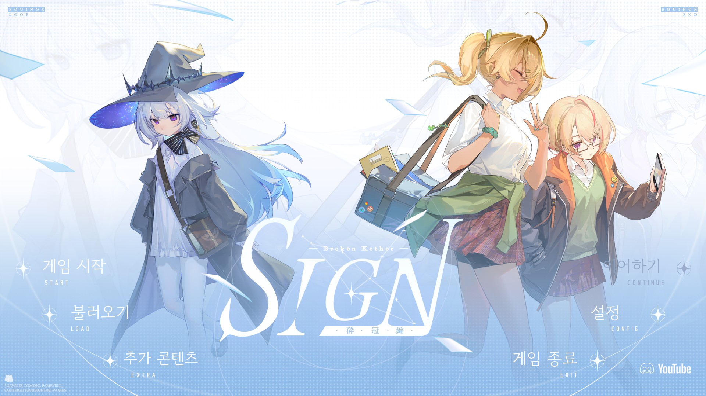
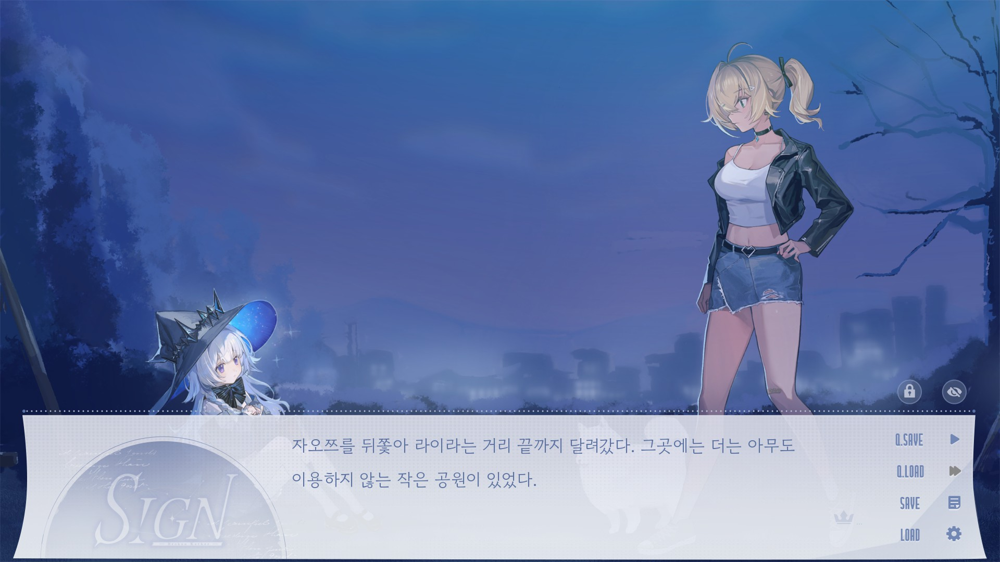
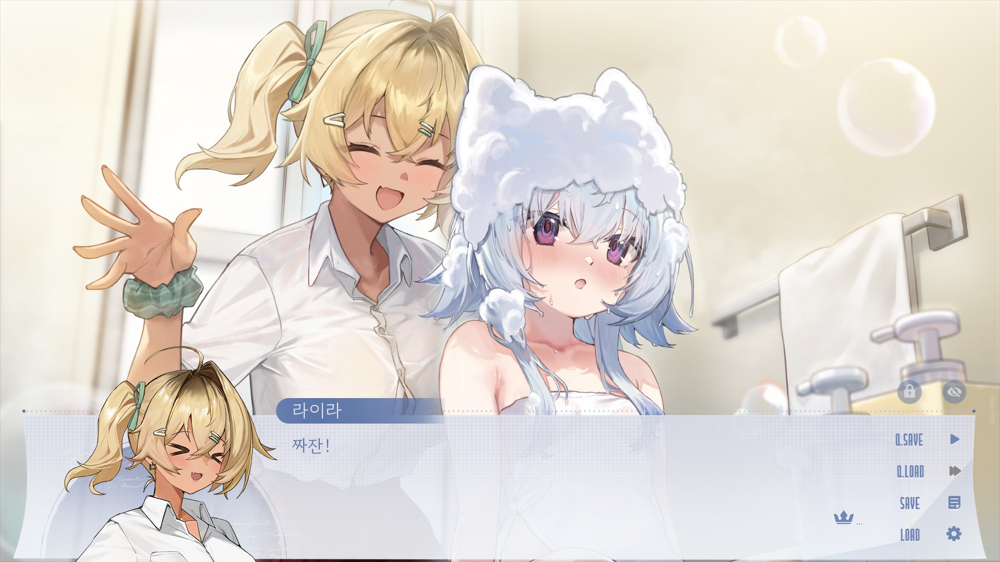

# Sign: Broken Kether 한국어 패치

Steam판 **Sign: Broken Kether** 비공식 한국어 패치 저장소입니다.

현재 버전은 `v1.0.1`이며 **Windows Steam 본편 1.05 / 빌드 26422637**을 지원합니다.

[Steam 공식 상점](https://store.steampowered.com/app/3788590/)

## 배포본

배포 파일은 이 저장소의 [릴리즈 페이지](https://github.com/etashi04/Sign-Broken-Kether/releases)에서 제공합니다.

- `Sign_Broken_Kether_Korean_Patch_v1.0.1.zip`: GUI 설치기를 통한 자동 설치·원본 복구
- `Sign_Broken_Kether_Korean_Patch_Manual_v1.0.1.zip`: 게임 실행 파일이 있는 폴더에 직접 복사
- `SHA256SUMS.txt`: 배포 ZIP 무결성 확인용 체크섬

게임을 종료한 상태에서 자동판과 수동판 중 하나만 설치하세요. 자동판에는 설치 EXE와 설치 안내문, 수동판에는 패치파일 폴더와 수동 전용 안내문이 포함되며, 두 배포본 모두 제3자 라이선스 고지를 제공합니다.

## 자동 설치

1. 게임을 종료하고 게임 폴더와 세이브를 백업합니다.
2. `Sign_Broken_Kether_Korean_Patch_v1.0.1.zip`을 게임 폴더 밖에 압축 해제합니다.
3. `Sign Broken Kether 한국어 패치 v1.0.1.exe`를 실행합니다.
4. 자동으로 찾은 설치 경로를 확인합니다. 찾지 못하면 **찾아보기**로 `SignI.exe`가 있는 폴더를 선택합니다.
5. **한국어 패치 설치**를 누르고 완료 후 Steam에서 실행합니다.

설치 경로는 이 PC의 Steam 라이브러리에서 자동으로 찾습니다. 찾지 못하면 입력란이 빈칸으로 표시됩니다.
첫 패치 실행에는 한국어가 자동 선택되며 이후 직접 고른 언어는 유지합니다. 한국어는 일본어 슬롯을 사용합니다.

## 수동 설치

1. 게임을 종료합니다. 기존 자동 패치가 있다면 먼저 해당 설치기로 원본을 복구합니다.
2. `SignI.exe`가 있는 폴더의 원본 `game` 폴더 전체와 세이브를 게임 폴더 밖에 백업합니다.
3. `Sign_Broken_Kether_Korean_Patch_Manual_v1.0.1.zip`을 압축 해제합니다.
4. **패치파일** 안의 모든 파일·폴더를 `SignI.exe`가 있는 위치에 복사하여 병합·덮어쓰기합니다. `패치파일` 폴더 자체를 넣지 않습니다.
5. Steam에서 실행합니다. 첫 실행 때 정품 원본으로 한국어 이미지·영상을 복원하므로 잠시 기다려 주세요. 별도 설치 도구나 Python 설치는 필요 없습니다.

첫 패치 실행의 한국어 기본값과 이후 언어 선택 방식은 자동판과 같습니다.

## 복구

- **자동판:** 게임 종료 후 설치기에서 같은 게임 폴더를 선택하고 **원본 복구**를 누릅니다. `Sign_KO_Backup`의 백업은 보존합니다. 복구 후 재설치하면 새 백업을 만들며 기존 이력을 지울 필요가 없습니다.
- **수동판:** 게임 종료 후 최신 세이브를 따로 보관합니다. 패치된 `game` 폴더의 이름을 바꿔 보관하고, 설치 전에 백업한 원본 `game` 폴더를 되돌린 뒤 최신 세이브를 필요에 따라 복원합니다. 원본을 덮어쓰기만 하면 추가된 패치 파일이 남습니다.

자동판 복구 버튼은 수동으로 복사한 패치를 제거하지 않습니다. Steam 무결성 검사도 추가된 패치 파일을 모두 지우지는 않습니다. 기본 세이브 위치는 `%APPDATA%\RenPy\sign1-full`이며 `game\saves` 또는 별도로 지정한 폴더도 확인하세요.

## 오류 해결

### 스마트 앱 컨트롤이 설치기 실행을 차단할 때

자동 설치 EXE는 디지털 서명이 없어 Windows 스마트 앱 컨트롤에서 차단될 수 있습니다. 오류 안내에서 스마트 앱 컨트롤에 의한 차단인지 먼저 확인하세요.

설치 EXE만 차단된다면 **수동 설치판**을 이용할 수 있습니다. 수동판은 설치 EXE를 실행하지 않고 `패치파일` 내용을 복사한 뒤 Steam에서 게임을 실행하는 방식입니다.

스마트 앱 컨트롤이 차단 원인이고 자동 설치판을 사용하려면 아래 설정을 끈 뒤 다시 실행할 수 있습니다. **이 설정은 PC 전체의 앱 실행 보호 수준을 낮추므로 변경 여부는 사용자가 판단해 주세요.** 변경 전 화면에 표시되는 재활성화 관련 안내와 [Microsoft 공식 안내](https://support.microsoft.com/ko-kr/windows/security/threat-malware-protection/smart-app-control-frequently-asked-questions)도 확인하세요.

1. **Windows 보안**을 엽니다.
2. **앱 및 브라우저 컨트롤 → 스마트 앱 컨트롤 설정**으로 이동합니다.
3. 설정 변경을 선택한 경우 **끄기**로 바꾼 뒤, 차단됐던 설치기를 다시 실행합니다.

게임 본체 실행이 차단되거나 차단 원인이 다르면 수동 설치만으로 해결되지 않을 수 있습니다. 문제가 계속되면 오류 문구와 차단된 파일명을 확인한 뒤, 저장소의 [이슈(Issues) 탭](https://github.com/etashi04/Sign-Broken-Kether/issues)에 제보해 주세요. 로그·스크린샷을 공개할 때는 사용자 이름과 개인 경로를 가려 주세요.

## 주의

- 원작자·개발사·배급사와 무관한 비공식 한국어 팬 패치입니다.
- 게임 업데이트 후 호환되지 않을 수 있습니다.
- 배포 파일은 `SHA256SUMS.txt`로 무결성을 확인할 수 있습니다.
- 개발팀의 무료·비상업적 배포 허락을 받은 팬 패치입니다. 공식 한국어판 또는 개발사 감수 번역을 의미하지 않습니다. 정품 게임이 필요합니다.
- 이미지·영상은 정품 원본에 적용하는 차이 데이터로 제공합니다. 원본 아카이브와 음성, 게임 통합본은 포함하지 않습니다.
- 제작자 이름·로고와 원본 영상에 이미 들어 있는 일부 원어·장식은 유지합니다. 한국어 음성은 제공하지 않습니다.
- 글리치 장면의 자모·가림 문자와 의도적 왜곡은 원작 연출을 반영합니다. 모코리스·동화는 원문 표기 또는 독음 확인 전의 잠정 표기입니다.
- 동봉 글꼴 등의 라이선스는 [THIRD_PARTY_NOTICES.txt](THIRD_PARTY_NOTICES.txt)에 있습니다.
- 다른 빌드·운영체제·모드와의 조합은 보장하지 않습니다. 설치 후 파일을 직접 수정하면 자동 복구가 중단될 수 있으므로 파일과 백업을 보존하세요.
- 오류 제보에는 패치 버전, 장·장면, 앞뒤 대사, 화면 캡처와 재현 방법을 적어 주세요. 로그나 세이브를 첨부할 때는 계정·개인 경로가 노출되지 않는지 확인해 주세요.
